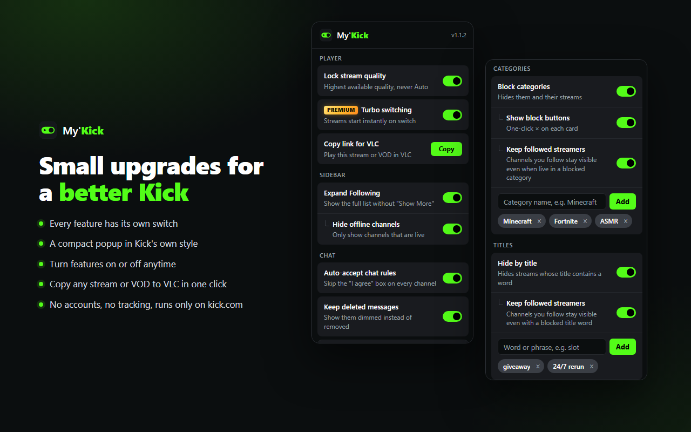
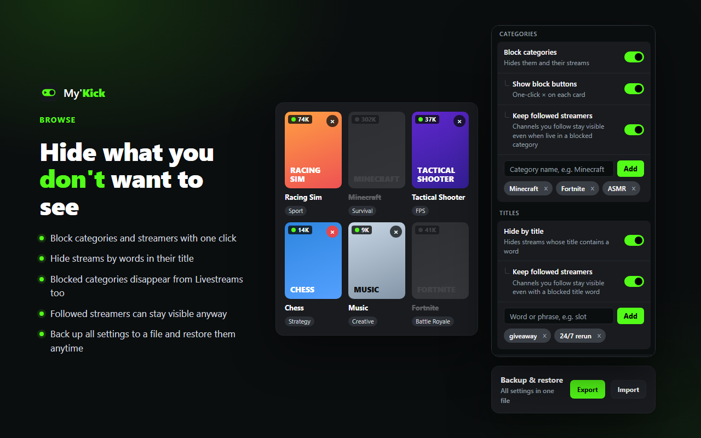
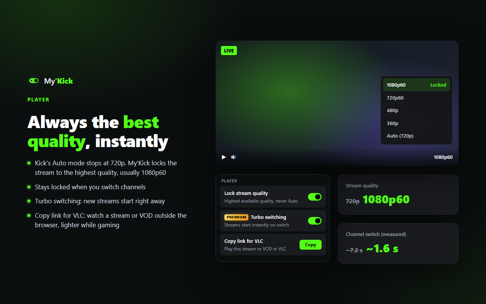
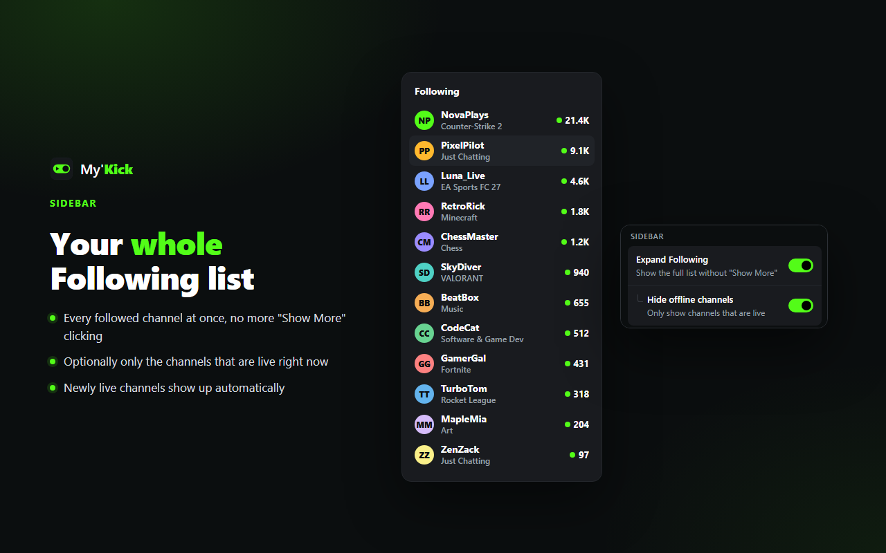
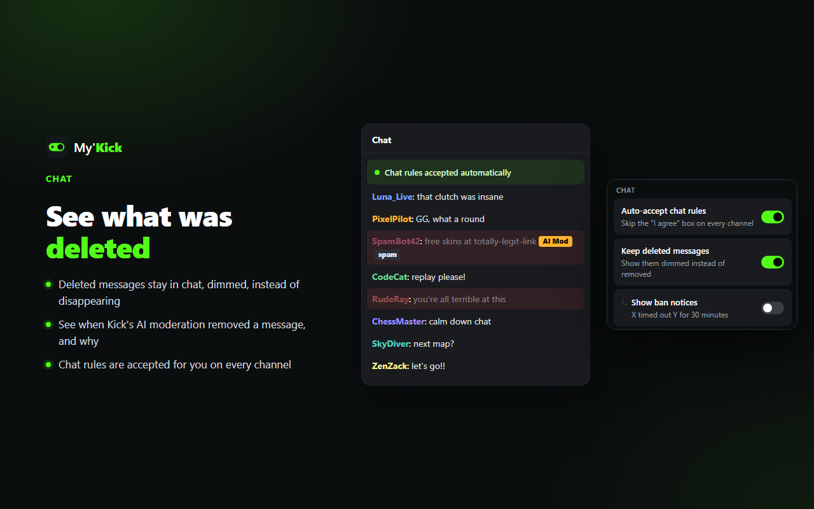

# My'Kick

**A cleaner, faster Kick.com: hide what you don't want to see, and always watch at the best quality.**

My'Kick is a small Chrome extension for Kick. Block streamers, categories and title words, lock streams to the highest quality, unlock subscriber-only VODs, keep your whole Following list open, and see chat messages that were deleted. Every feature has its own switch.

No account, no tracking, no ads, and no server of its own. It runs only on kick.com, and your settings stay in your browser.

## Features

### Filtering

- **Block streamers:** hide streams by name on Browse › Livestreams. Matching ignores case and works with the display name or the channel slug.
- **Block categories:** hide categories on Browse › Categories, along with their streams on Browse › Livestreams. `call of duty mobile` matches `Call of Duty: Mobile`.
- **Hide by title:** hide streams whose title contains a word or phrase. Matching ignores case and accents, and understands Turkish letters (`KUMAR` = `kumar`, `ÇIKIŞ` = `cikis`).
- **One-click block buttons:** a small × on each card adds it to your block list.
- **Keep followed streamers:** a channel you follow stays visible even if it's live in a blocked category or has a blocked word in its title. Streamers you blocked by name stay hidden.

### Player

- **Lock stream quality:** always plays the highest available quality (usually 1080p60) instead of Kick's Auto mode, which stops at 720p on desktop. It stays locked when you switch channels.
- **Keep quality in background:** Kick lowers the stream quality after its tab has been in the background (another tab, or the window minimized) for a minute. This keeps the quality you were watching until you come back.
- **Unlock Sub-Only Videos:** on a subscriber-only VOD, replaces Kick's lock with a working player and plays the channel's chat back on the right, in sync with the video, the same as a normal VOD. The stream is resolved from Kick's own public video list; no subscription token is used. Off by default.
- **Turbo switching:** if you use an ad blocker, Kick waits several seconds on every channel switch. This removes the wait (measured at about 7 s down to about 1.6 s).
- **Copy link for VLC:** copies a direct `.m3u8` link for the live stream, VOD or clip in the current tab, for VLC or mpv. Watching there skips the site's chat and scripts, which helps while gaming.

### Sidebar

- **Expand Following:** shows your whole Following list at once, with no "Show More" clicks.
- **Hide offline channels:** shows only the channels that are live.

### Chat

- **Keep deleted messages:** deleted messages stay in chat, dimmed on a faint red background, with the "AI Mod" tag and the violated rule when AI moderation removed them. Messages from banned or timed-out users stay too. Messages deleted before you opened the chat can't be recovered.
- **Show ban notices:** shows `<mod> timed out <user> for 30 minutes` lines in chat. Turn it off to keep them out.
- **Auto-accept chat rules:** the "Chat Rules / I agree" box never shows up.

### Backup

**Export** saves every toggle and block list to a JSON file, and **Import** restores it after a reinstall. Import replaces all settings, drops unknown keys and wrong types, and removes duplicates.

## Install

1. Download this repository ([ZIP](https://github.com/eldrova/my-kick/archive/refs/heads/main.zip)) and unpack it, or clone it.
2. Open `chrome://extensions` and turn on **Developer mode**.
3. Click **Load unpacked** and select the folder that contains `manifest.json`.
4. Reload any open Kick tabs.

On a fresh install, the Browse filters and the chat tools are on (block lists with their buttons, Hide by title, Keep followed streamers, Auto-accept chat rules, Keep deleted messages, Show ban notices). The Player features (Lock stream quality, Keep quality in background, Turbo switching, Unlock Sub-Only) and the Following features (Expand Following, Hide offline channels) are off until you enable them in the popup. The block lists start empty, so nothing is hidden until you add entries.

After changing files, press the reload icon on the extension card and reload Kick.

## Privacy

Settings, block lists and a cached copy of your follow list (slugs and names only) are stored locally with `chrome.storage`.

The extension only asks for the `storage` permission and access to `kick.com`. It talks to Kick's own endpoints, using your existing session, to load your follow list and resolve stream links, and it checks those links against the video hosts that serve Kick's streams. It has no server of its own and collects nothing.

## How it works

See [docs/how-it-works.md](docs/how-it-works.md) for the technical details: how each feature hooks into Kick's player, chat store and APIs, the project layout, and how to add a feature.

## Disclaimer

This is an independent project. It isn't affiliated with or endorsed by Kick. Kick can change its site at any time, which may break individual features.
